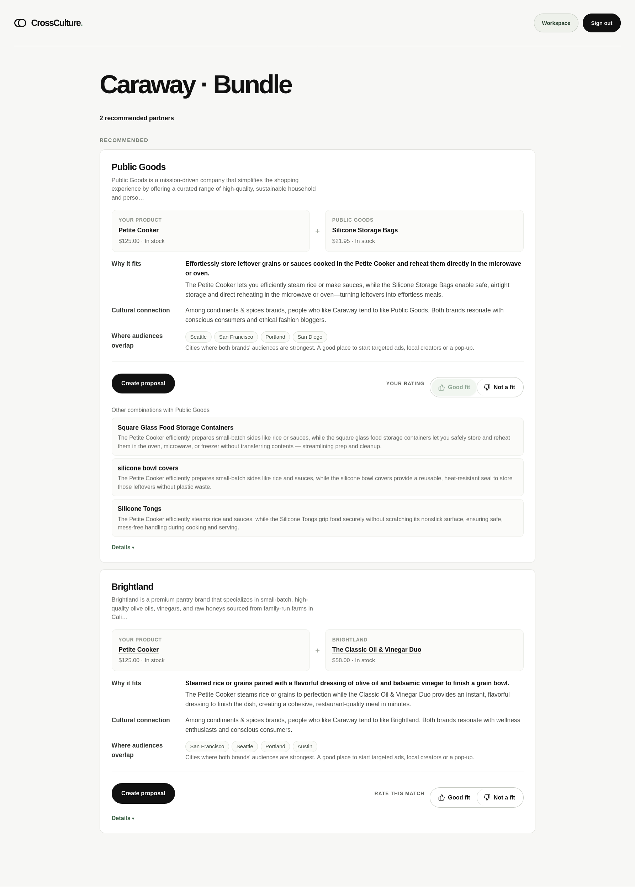
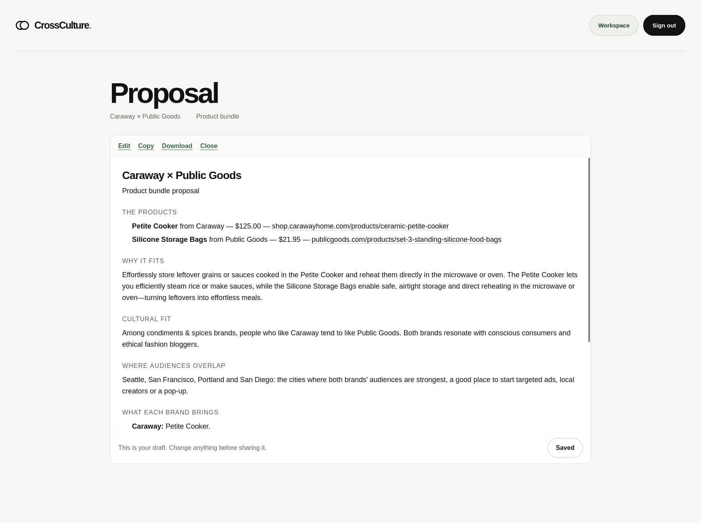

# CrossCulture

**Find brands your customers already like, and the exact products you could sell together.**

CrossCulture helps a consumer brand plan product bundles and cross-sells with another brand. You pick one of your products. The app uses Qloo to find brands your audience already likes, checks those brands' live Shopify stores for products that work with yours, and shows the strongest pairs with the reason for each. You can also name a brand you already have in mind and compare the two directly.

**[Try the live app](https://culture-circle.vercel.app/)**

## The problem

A brand that wants a partner for a bundle or cross-sell has two questions to answer:

1. **Would my customers care about this brand?** Partnerships work when both brands share a core customer but do not compete.
2. **Do our products actually belong together?** A good bundle does one job together, such as a blanket and the bag that carries it. A good cross-sell meets a real need or moment for the buyer. Two unrelated items with a discount are neither.

Today this is manual. Searching by product category mostly finds competitors (a coffee maker search returns other coffee makers), and the best partners are often in a different category entirely. Checking every candidate's store and products by hand does not scale.

## The solution

CrossCulture answers both questions in one research run:

1. **Choose your brand, market, goal (Bundle or Cross-sell) and starting product.** The app confirms your brand and its Shopify store.
2. **Find partners.** Qloo recommends brands from your brand's taste profile, across categories. The app also asks Qloo for brands your audience likes within categories that suit your product, for example coffee brands for a coffee maker.
3. **Check real products.** For each partner, the app confirms its official store, searches its live catalog for items that work with your product, and assesses exact products and variants.
4. **Keep only strong pairs.** A **bundle** is recommended only when the two items do one job together (a bag carries the blanket, a strainer drains what the pot cooked). A **cross-sell** must meet a practical need of your buyer, or play a clear role with your product in a specific experience or occasion, routine or look.
5. **Review and act.** Each result shows why the products fit, the cultural connection, cities where both audiences are strong, current prices, and open questions. A result can become an editable partnership proposal.
6. **Rate the results.** Your ratings shape your next runs for the same brand.

### Ratings that shape the next run

Each result can be rated once, and the reason you give decides how far the rating reaches:

| Rating | What changes next time |
|---|---|
| **Good fit** | That exact product pair is re-checked first and shown at the top, and the partner is researched earlier. |
| **Not a fit** · *products don't go together* | That pair is never shown again; the partner's other products can still appear. |
| **Not a fit** · *not right for my brand*, *already working with them*, *not credible* | That partner is skipped for your brand. |

Ratings are personal: they change your own runs, not other users' results.

### Example

In a US Bundle run for Rumpl's *Original Puffy Blanket – Grand Teton*, Qloo's recommendations for Rumpl included **United by Blue**. The app verified United by Blue's store and found supported combinations, including the **(R)evolution™ 55L Carry-On Duffle**, which carries and protects the blanket on a trip. Separately, Qloo's audience tags placed *environmental advocates* and *sustainability advocates* in the top half of both brands' lists, and that is the cultural connection shown with the result.

## Screenshots

**Partnership recommendations:** a completed Caraway product-bundle search with product pairs, cultural context, and next steps.



**Editable proposal:** the saved draft for a selected pairing, with product links and the evidence behind it.



## Why Qloo

Qloo answers the first question, *would my customers care about this brand?* Without it, the options are category search, which returns competitors, or guesswork. Qloo links brands through the tastes of the people who like them, so it finds non-competing brands in other categories that share your audience: a blanket brand's audience leads to bag and outdoor brands, a cookware brand's audience to tableware and pantry brands.

Qloo does not decide whether two **products** go together. That second question is answered from the partner's live Shopify catalog and the product checks above. Every suggested partner comes from Qloo, and a partner you name yourself still needs a Qloo link to be recommended.

| Step | Qloo request | Why |
|---|---|---|
| Identify your brand | `qloo_describe`, brands only | Makes sure the app uses your brand, not a person or product with the same name. |
| Suggest partners | `qloo_recommend` with your brand as the only input (up to 12 brands) | Brands your audience likes, in any category. Shown as "People who like A also tend to like B." |
| Partners for your product | The same request, limited to one Qloo brand category at a time; the app picks up to two categories from your product's description | Finds partners the brand-wide list misses, such as coffee brands for a coffee maker. Shown as "Among coffee & tea brands, people who like A tend to like B." |
| Compare two named brands | Checks whether each brand appears in the other's `qloo_recommend` list; if not, `qloo_rank` plus a specific shared tag that both brands' own websites mention | A brand you name is not assumed to fit; the cultural link has to be found. |
| Explain the connection | Audience and lifestyle tags for each brand (`/v2/insights`, filtered by tag type) | Names the audience both brands share, using tags that rank high for both and are not common to nearly every brand. |
| Where to launch | `qloo_where_popular` for each brand | Cities where both audiences are strong, a starting point for local campaigns. |

Qloo calls go through the pinned `@qloo/qloo-harness` MCP package. The audience-tag query calls the gateway's read-only `/v2/insights` endpoint directly with the same server-side credential, because the harness does not expose the tag-type filter. Qloo responses are cached privately per user, and credentials never reach the browser.

## Run it locally

You need **Node.js 22.19+**, a Supabase project, a Qloo hackathon credential, a Tavily key, and either AWS Bedrock access or an OpenAI-compatible model endpoint. Shopify Catalog access also needs a public HTTPS URL serving the included [`ucp-agent-profile.json`](web/public/ucp-agent-profile.json).

```sh
git clone https://github.com/Huzaifa-Aqeel/culture-circle.git
cd culture-circle
(cd api && npm ci)
(cd web && npm ci)
cp .env.example .env.local
cp web/.env.example web/.env.local
```

In `.env.local`, set `DATABASE_URL`, `SUPABASE_URL`, `SUPABASE_PUBLISHABLE_KEY`, `QLOO_API_KEY`, `QLOO_BASE_URL` (`https://hackathon.api.qloo.com`), `TAVILY_API_KEY`, `SHOPIFY_UCP_PROFILE_URL` and the model settings shown in [`.env.example`](.env.example). Leave `RESEARCH_WORKER_FUNCTION_NAME` empty so the API runs research in-process.

In `web/.env.local`, set `NEXT_PUBLIC_SUPABASE_URL` and `NEXT_PUBLIC_SUPABASE_PUBLISHABLE_KEY`, and keep `CROSSCULTURE_API_URL=http://127.0.0.1:8787`. Apply the database migrations with `npx supabase db push`.

```sh
(cd api && npm run dev)   # API and research worker on :8787
(cd web && npm run dev)   # web app on :3000
```

Open `http://localhost:3000`, sign in, and try a US brand that sells on Shopify. Offline tests run with `(cd api && npm test)` and make no provider calls.

## Limits

- Results are a starting point for a partnership conversation. Qloo affinities and city popularity are aggregate signals: they do not identify shared customers, predict sales, or show that a partner is interested.

- Your brand must be in Qloo, and partners must sell on Shopify with a verifiable store.
- Qloo's categories are broad and have no cookware, pet-supply or outdoor-gear category, so partners for those products come only from Qloo's general suggestions for your brand.

- Some runs end without a recommendation: Qloo may suggest no partners with relevant products, a partner's store may not be verifiable, or no reviewed pair may meet the bar. An empty result, especially from a run that hit its time limit, does not prove that no good partner exists.

## License

[MIT](LICENSE) © 2026 Huzaifa Aqeel.

Built for the Qloo Agentic Hackathon.
